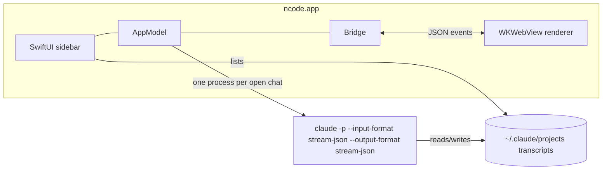

# ncode

A tiny native Mac app for [Claude Code](https://docs.claude.com/en/docs/claude-code/overview). It puts the terminal experience in a clean chat window: projects in a sidebar, rich rendering, and live views of the commands and subagents Claude is running.

- **~4 MB app**, under 1 MB of native code. Native SwiftUI shell, one system WebView for the chat. No Electron, no Node at runtime.
- **Uses your installed `claude` CLI.** Your login, settings, `CLAUDE.md`, skills, plugins, hooks, MCP servers and permission rules all work as they do in the terminal.
- **Same sessions as the terminal.** Add a project folder and its past Claude Code sessions from the terminal show up under it, ready to resume. The sidebar starts empty and only shows folders you add.

> Unofficial. Not affiliated with Anthropic.

## Features

| Area | What you get |
|---|---|
| Projects | Sidebar of the folders you add (⌘O), each with its past sessions by title. Live status dots for running, waiting for approval, and background tasks. |
| Chat | Streaming markdown with GFM tables, task lists, syntax-highlighted code with copy, KaTeX math, Mermaid diagrams, images (paste, drag-drop or attach), summarized thinking. |
| Tools | Every tool call as a compact row: Bash with output, Read, Write, Edit diffs with line numbers, Grep/Glob, web, MCP tools, todo lists. |
| Subagents | Each subagent gets a live card with its type, task, current step, tool and token counts, duration, a Stop button, and its full nested transcript. |
| Activity panel (⌘J) | What is running right now, all subagents and background tasks (stop or background them), context-window breakdown, session info, MCP server status with reconnect. |
| Permissions | Inline approve/deny cards with diffs and command previews. Supports "always allow" rules, plan approval, and `AskUserQuestion` multiple choice. |
| Composer | `/` command and skill autocomplete, `@` file mentions, `!` shell mode, ↑ prompt history, prompt suggestions (⇥), queueing while Claude works. |
| Controls | Permission mode (⇧⇥ to cycle), model and effort picker, interrupt (esc), `/compact`, `/context`, `/usage` and every other slash command the CLI supports in headless mode. |
| Escape hatch | "Open in Terminal" resumes the same session in the full TUI. |

## Install

Requirements: macOS 14+, Xcode command line tools (Swift 5.10+), and [Claude Code](https://docs.claude.com/en/docs/claude-code/setup) installed and logged in.

```bash
git clone https://github.com/nishantkumar1292/ncode.git
cd ncode
./build.sh --install     # builds build/ncode.app and copies it to /Applications
```

`--install` also puts a small `ncode` command on your PATH, so you can open a folder from the terminal:

```bash
ncode .            # like `code .`; works whether or not the app is running
```

## Adding projects

The sidebar starts empty. Press **⌘O** (or **+**) to open the project finder:

- It lists the folders you've used Claude Code in, most recent first, and git repos in common code folders (`~/dev`, `~/code`, `~/src`…). Type to fuzzy-search.
- Type a path starting with `~/` or `/` to browse like `cd`: **⇥** completes a folder, **⌫** on a trailing `/` goes up a level.
- **↩** adds the folder and opens a chat. **⌘↩** adds it and keeps the finder open.
- **Browse in Finder…** (⇧⌘O) is still there for anything else.

You can also drop a folder on the sidebar, the welcome screen or the Dock icon.

The finder only reads Claude Code's own records (`~/.claude.json`, `~/.claude/history.jsonl`) and scans common code folders. It never scans Desktop, Documents or Downloads, so it doesn't trigger macOS privacy prompts.

## Keyboard

| Keys | Action |
|---|---|
| ↩ / ⇧↩ | Send / new line |
| esc | Stop Claude (or deny a permission card) |
| ⇧⇥ | Cycle permission mode: ask → accept edits → plan → auto |
| ⌃B | Send running commands and subagents to the background |
| ⌘N | New chat in the current project |
| ⌘O | Add a project (finder) |
| ⇧⌘O | Add a project with the system folder dialog |
| ⌘J | Toggle the activity panel |
| ⌘L | Focus the composer |
| ⇧⌘T | Open this session in Terminal |
| ↑ | Previous prompt |
| `/` `@` `!` | Commands, file mentions, shell mode |

## How it works



- Each open chat runs `claude` in headless streaming mode, the same protocol the official Agent SDK uses. Messages, tool calls, subagent events and permission requests arrive as JSON lines.
- Swift is a thin pipe: it manages processes, reads transcripts for the sidebar, and serves files. The web renderer (`Resources/web`) owns the protocol and the UI.
- Permission prompts come in as `can_use_tool` control requests and are answered from the inline cards.
- The app loads your login shell environment once, so `claude` and every command it runs see the same `PATH` as your terminal.

## Project layout

```
Sources/ncode/
  App.swift          window, menus, sidebar
  AppModel.swift     projects, sessions, notifications, launch args
  Session.swift      one `claude` child process per chat
  Bridge.swift       WKWebView + JS bridge + local file scheme
  ProjectStore.swift added folders + their sessions from ~/.claude/projects
  ProjectFinder.swift candidates for the ⌘O project finder
  FileIndex.swift    @-mention file list
  ShellEnv.swift     login-shell env and `claude` lookup
Resources/web/
  index.html, app.css, app.js, markdown.js, vendor/ (marked, DOMPurify, highlight.js, KaTeX, Mermaid)
```

## Limits

Things that only exist as interactive terminal screens don't come through the headless protocol: for example the `/config` editor, `/login`, and the `/agents` and `/mcp` management screens. Use **Open in Terminal** (⇧⌘T) for those. It resumes the same session.

## License

MIT

## Credits

Bundled libraries: [marked](https://github.com/markedjs/marked) (MIT), [DOMPurify](https://github.com/cure53/DOMPurify) (Apache-2.0/MPL-2.0), [highlight.js](https://github.com/highlightjs/highlight.js) (BSD-3-Clause), [KaTeX](https://github.com/KaTeX/KaTeX) (MIT), [Mermaid](https://github.com/mermaid-js/mermaid) (MIT).
